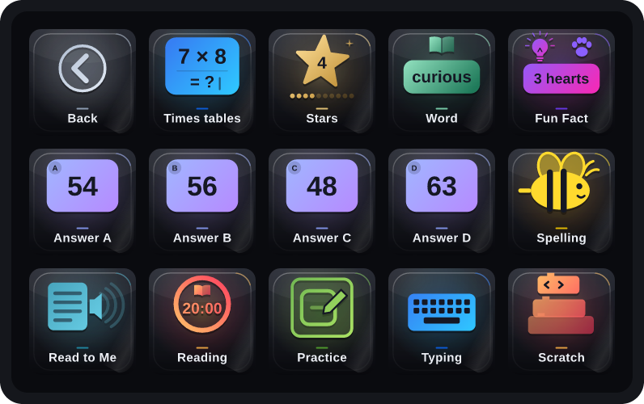
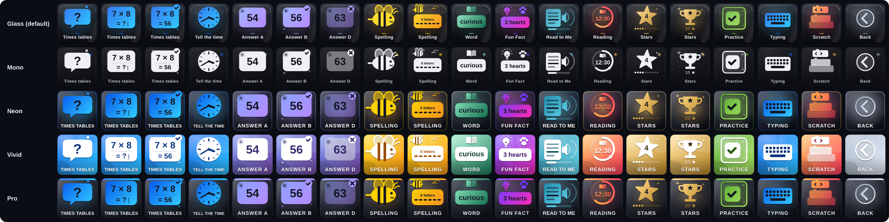

# Learning Deck

Elgato Stream Deck plugin with learning keys for kids (made for an 8-year-old). Version 1.0.0.0, Windows 10 and 11.

Maths, times tables, division, telling the time, spelling, a word of the day, fun facts, read-aloud, a reading timer, a star chart, daily task ticks and kid-safe learning sites. Every key speaks in the Windows voice and draws in the same Design System 4 looks as Windows Toolkit, with **Glass** as the default.



**Safe by design:** no accounts, no sign-in, no internet needed (except the Learning Site key, which only opens the site you pick in the browser). Nothing about the child is collected or sent anywhere. The only thing saved is a small progress file on this PC with star counts and which task keys were ticked today.

## Install

**From a release:** download **LearningDeck-Installer-1.0.0.0.zip** from [Releases](https://github.com/nikhilgs817/streamdeck_niharika/releases/latest), extract it, and double-click **Install-LearningDeck.cmd**.

**From source** (Node.js 20 or later):

```powershell
npm ci
npm run build
npm run pack
npm run build:installer
.\dist\LearningDeck-Installer\Install-LearningDeck.cmd
```

The installer checks Stream Deck 7.1+, verifies the package, backs up your setup, keeps your existing layouts, adds the **Learning Deck** profile and rolls back if startup fails. Windows Toolkit is not needed. [Full installation guide](docs/INSTALL.md).

## The keys

The bundled 15-key **Learning Deck** profile:

| | | | | |
|---|---|---|---|---|
| Back | Question | Star Chart | Word of the Day | Fun Fact |
| Answer A | Answer B | Answer C | Answer D | Spelling Bee |
| Read to Me | Reading Timer | Task Done | Typing (site) | Scratch (site) |

| Key | Tap | Double-tap | Hold (1 s) |
|---|---|---|---|
| **Question** | Hear the question again. With no Answer keys on the deck it works as a flash card: tap to see the answer, tap again for the next | Next subject | Skip to a new question |
| **Answer A–D** | Pick that answer. Right turns green, says well done and earns a star on the first try; wrong shakes gently and says try again | | |
| **Spelling Bee** | Hear a word to spell. Tap again to see it spelled out and hear the letters (earns a star) | | Hear the word again |
| **Word of the Day** | Hear the word, its meaning and an example. A new word every day | | A bonus word |
| **Fun Fact** | A new fact about space, animals, nature or the body, read aloud | | |
| **Read to Me** | Copy text (Ctrl+C), then tap to hear it. Tap again to stop | | |
| **Reading Timer** | Start or pause (20 minutes by default). Chimes, says well done and earns a star at the end | | Reset |
| **Star Chart** | Hear today's stars. Shows a trophy at the daily goal | | Reset (3 s, for grown-ups) |
| **Task Done** | Tick a daily routine (like "Piano") and earn a star. Clears overnight | | Untick |
| **Learning Site** | Open the site on screen 1 | Screen 2 | Screen 3 |
| **Back** | Return to your previous keys | | |

**Question subjects:** plus and minus, times tables (all or one table from 2 to 12), division, mixed maths, missing letter and telling the time. Levels: Easy, Medium (age 8) and Hard. Two, three or four choices.

**Learning sites:** TypingClub, Scratch, Code.org, Khan Academy Kids, Khan Academy grade 3 maths, NASA Space Place, National Geographic Kids, PBS KIDS games, or any other `http`/`https` address. Each preset has its own key art. Choose whether the site opens with tap / double-tap / hold on screens 1 / 2 / 3, always on one screen, or wherever Windows puts it, and how screens are numbered.

**Your own words:** the Spelling Bee and the Question key's missing-letter subject take your own list (commas or new lines). Word of the Day takes `word = meaning` lines.

**Voice:** the built-in Windows voice (System.Speech), offline. Slow, normal or fast, per key. Questions can be silent.

## Looks



The same look settings as Windows Toolkit: **Glass** (default), Vivid, Neon, Mono and Pro; Full, Glow only, Icon only or Still animation at four speeds; glow strength; the press ripple; label case; custom two-colour keys; and **Use this look on all keys**. Keys stay still while Windows **Animation effects** is off. The learning art (question cards, answer tiles, the bee, the book timer, stars and so on) is drawn inside the shared design system, so it changes with the look.

## Build and test

```powershell
npm ci
npm run build          # manifest, images, profile and bundle
npm test               # content and art checks, settings panel, simulated Stream Deck (no hardware)
npm run check:design   # Design System 4 matches a windows_toolkit clone next to this one
npm run validate       # Elgato's validator
npm run pack
npm run build:installer
npm run test:installer # Windows only, isolated fixtures
npm run preview        # re-render docs/images
```

`npm test` drives every key on a simulated Stream Deck in dry-run mode: it answers quiz questions right and wrong, spells, reads, runs the timer to the chime, ticks tasks, opens sites on each screen, refuses unsafe addresses and checks every image.

## Files

- `plugins/learning/content.js` questions, spelling lists, words, facts and sites
- `plugins/learning/art.js` the learning key art
- `plugins/learning/catalogue.mjs` the keys and their settings (drives the manifest and settings panel)
- `plugins/learning/src/` key behaviour, speech and progress
- `shared/` Design System 4, copied unchanged from [Windows Toolkit](https://github.com/nikhilgs817/windows_toolkit)

Progress file: `%APPDATA%\LearningDeck\progress.json`. Plugin logs: `%APPDATA%\Elgato\StreamDeck\Plugins\com.windowstoolkit.learning.sdPlugin\logs`.

## Licence

MIT. Site names belong to their owners; this plugin only opens their public pages.
